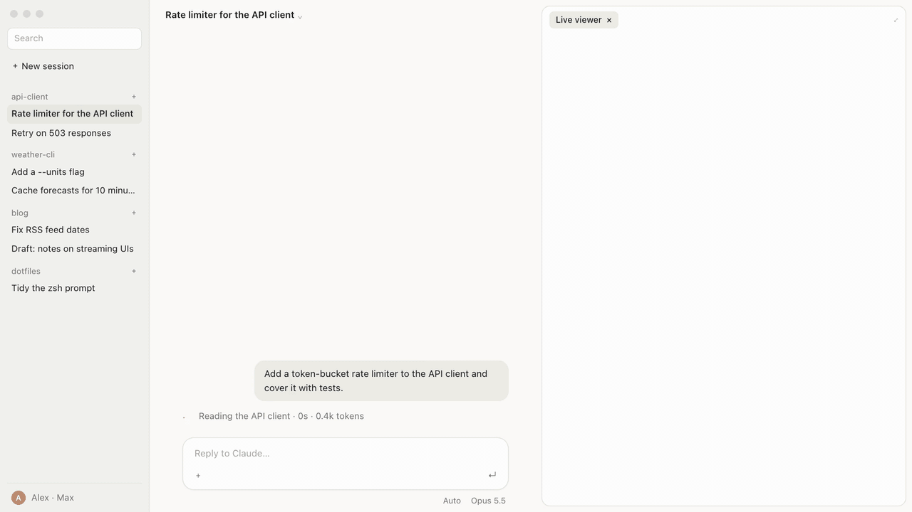
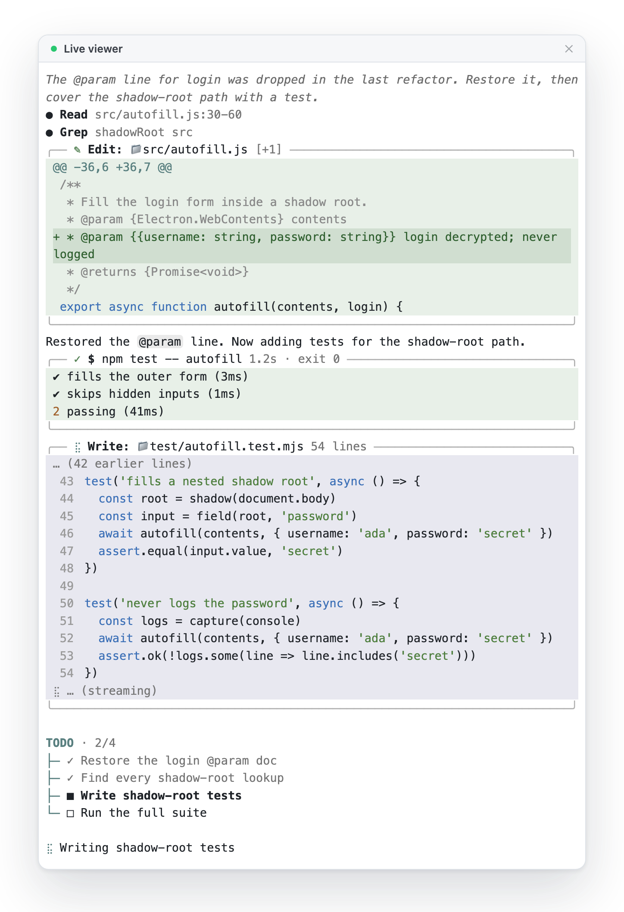

<div align="center">

[English](README.md) · **한국어**

# live-viewer

**Claude Code가 쓰는 내부 코드를 바로 보게 해 주는 UI mod입니다.**

Claude Code의 도구 호출을 옆 패널 탭에 실시간으로 스트리밍해 줍니다.

1\. 당신이 바이브 코더라면, 코딩 기분을 낼 때 좋습니다.<br>
2\. 당신이 현직 개발자인데 Claude Code 공식 앱을 좋아한다면, 코드 내부를 들여다볼 수 있어서 좋습니다.<br>
3\. 예쁩니다.

[](https://github.com/moneycode11101-svg/claude-code-live-viewer/actions/workflows/test.yml) [](LICENSE) [](#지원-범위)



<sub>이 페이지를 위해 재구성한 예시 세션입니다. 실제 프로젝트 화면이 아닙니다.</sub>

[설치](#설치) · [보이는 것](#보이는-것) · [설정](#설정) · [작동 방식](#작동-방식)

</div>

## 왜 쓰나

Claude Code는 도구 호출이 완전히 끝난 뒤에야 내용을 보여 줍니다. 긴 `Write`나 `Edit`가 끝날 때까지는 스피너만 돌고, 완료된 뒤에도 대화창 안에 접혀 버립니다. `live-viewer`는 대화창 옆에 탭을 열어 모델이 작성 중인 호출을 실시간으로 보여 줍니다. 파일이 한 줄씩 늘어나는 모습, diff가 잡혀 가는 모습, 곧 실행될 명령어가 그대로 보입니다. 엉뚱한 방향으로 흘러가면 일찍 알아채고 `Esc`를 눌러 멈출 수 있습니다.

## 설치

```bash
claude plugin marketplace add moneycode11101-svg/claude-code-live-viewer
```

```bash
claude plugin install live-viewer@live-viewer
```

새 Claude Code 세션을 시작하면 탭이 자동으로 열립니다. 탭을 닫았더라도 `/live`를 입력하면 다시 열립니다. 시스템 로캘이 한국어이거나 시간대가 서울(`Asia/Seoul`)이면 탭 제목과 UI가 한국어(**코딩 뷰어**)로 표시됩니다.

## 보이는 것

<p align="center">
<picture>
  <source media="(prefers-color-scheme: dark)" srcset="docs/hero-dark.png">
  
</picture>
</p>

| 호출 | 표시 형태 |
|---|---|
| `Write` | 파일 경로가 제목으로 달린 상자. 작성 중에는 줄 번호와 함께 마지막 12줄을, 완료 후에는 첫 3줄과 전체 줄 수, 새 파일 여부를 보여 줍니다 |
| `Edit` | 실제 줄 번호가 붙은 diff 상자. `[+추가 -삭제]` 형태로 표시합니다 |
| `Bash` | 명령어가 제목으로 달린 상자. 완료 후에는 출력의 마지막 3줄, 소요 시간, 종료 코드를 보여 줍니다 |
| `Read`, `Grep`, `Glob`, `WebFetch`, `WebSearch`, `Agent` | 한 줄 요약: `● Read src/app.ts:30-60` |
| 생각, 답변 | 생각은 이탤릭체, 답변은 Markdown으로 렌더링 |
| 할 일 목록 | 하단 트리에 `완료/전체` 개수와 현재 진행 중인 단계 표시 |

상자 색상은 호출 상태(진행 중·완료·실패)를 따릅니다. `Esc`로 중단되거나 권한이 거부된 호출도 구분해 표시합니다. 새 호출이 들어오면 탭은 자동으로 맨 아래로 스크롤됩니다. 내용을 읽으려고 위로 스크롤하면 자동 스크롤이 멈추고, 다시 맨 아래로 내리거나 새 프롬프트를 보내면 다시 따라갑니다.

데스크톱 앱에서 아직 탭이 배치되지 않았을 때는 작성 중인 호출 상자를 대화창 스피너 바로 위에 대신 그립니다.

## 설정

Claude Code 안에서 `/plugin configure live-viewer@live-viewer`를 실행하거나, 설치할 때 옵션을 지정합니다.

```bash
claude plugin install live-viewer@live-viewer --config palette=dark
```

| 설정 | 값 | 기본값 |
|---|---|---|
| `language` | `auto`, `en`, `ko` | `auto`: 로캘(`LC_ALL`, `LC_MESSAGES`, `LANG`)이 `ko`로 시작하거나 시간대가 `Asia/Seoul`이면 한국어, 그 외에는 영어 |
| `palette` | `auto`, `light`, `dark` | `auto` (데스크톱 앱은 밝은 테마, 터미널은 터미널 테마를 따름) |
| `debug` | `true`, `false` | `false`. 켜면 Claude 설정 폴더의 `live-viewer/status/`에 세션별 상태 파일을 기록합니다 |

## 지원 범위

| 환경 | 상태 |
|---|---|
| Claude Code 2.1.302, macOS 데스크톱 앱 | 테스트 완료 (2026-10-17) |
| 터미널 환경의 Claude Code | 아직 테스트 안 함 |
| Linux, Windows | 아직 테스트 안 함 |
| 2.1.302 이전 버전의 Claude Code | 테스트 안 함. mod는 새로운 기능이라 버전마다 API가 바뀝니다 |
| `claude -p` 등 헤드리스(headless) 실행 | 표시할 화면이 없으므로 탭을 열지 않습니다 |

## 작동 방식

`live-viewer`는 엔진 이벤트를 감지하는 hooks 모듈 기반의 Claude Code mod(플러그인)입니다.

- **`turn.step`**: 모델이 각 단계에서 스트리밍하는 청크(chunk)를 읽습니다. 원본 청크는 그대로 통과시키고, `Write`·`Edit`·`Bash` 입력의 조각난 JSON을 도착하는 대로 실시간 파싱합니다.
- **`tool.call`**: 호출을 실행 중 상태로 표시하고, 실행이 끝나면 결과를 덧붙입니다. 결과값은 건드리지 않고 그대로 반환합니다.
- **`ui.render`**: `Pane` 탭을 그리며, 탭이 아직 배치되지 않았을 때는 `Spinner` 영역에 그립니다.

Claude의 원래 동작을 막거나 지연시키거나 바꾸지 않습니다. 탭 화면 갱신은 최대 33ms당 한 번으로 묶어서(batch) 처리합니다. 3,000줄짜리 `Write` 작업을 재현해 측정한 청크당 추가 소요 시간은 약 0.03ms(p95)로, 뷰어를 껐을 때와 차이가 없습니다. 만약 뷰어에서 오류가 한 번이라도 발생하면 해당 세션에서는 즉시 비활성화되며, 작업 중인 세션은 끊김 없이 그대로 이어집니다.

## 업데이트와 제거

```bash
claude plugin update live-viewer@live-viewer
```

```bash
claude plugin uninstall live-viewer@live-viewer
```

## 개발

```bash
git clone https://github.com/moneycode11101-svg/claude-code-live-viewer.git
```

```bash
claude plugin validate --strict .
```

```bash
claude plugin test .
```

클론한 폴더에서 `claude --plugin-dir .` 명령으로 Claude Code를 실행하면 로컬 버전을 바로 테스트해 볼 수 있습니다.

## 출처

상자 레이아웃과 밝은·어두운 팔레트 디자인은 [oh-my-pi](https://github.com/can1357/oh-my-pi)(MIT)를 참고했습니다. 자세한 내용은 [NOTICE](NOTICE)를 확인하세요.

## 라이선스

[MIT](LICENSE)
